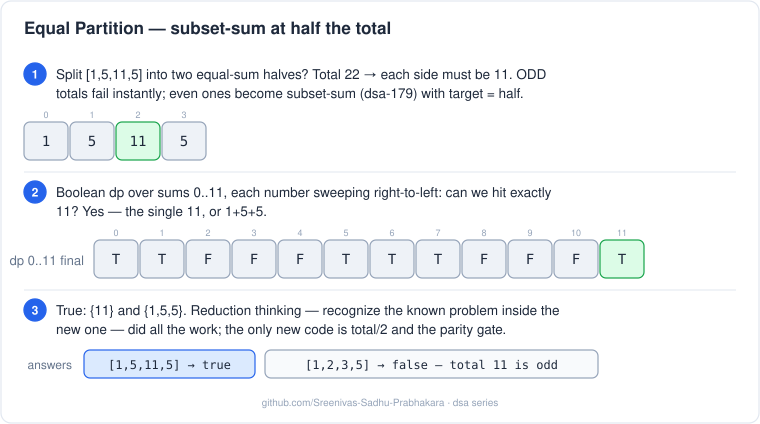

# Partition Equal Subset Sum

> NeetCode 150 · 1-D DP — reduce to subset-sum at half the total: an odd total fails instantly, and one boolean row answers the rest. Go, stdlib only, tested.

## Problem

Can the array be split into two subsets with equal sums? `[1,5,11,5]` yes ({1,5,5} vs {11}); `[1,2,3,5]` no.

## Approach

The reduction is the whole problem: two equal halves must each sum to total/2, so the question is exactly "does some subset reach total/2?" — dsa-179's subset-sum, with an odd total rejected before any DP runs. The boolean row sweeps backwards per element (the 0/1 discipline), plus one earned optimization: return the moment the target lights up, since later elements can't unlight it. Knowing which named problems are reductions of which — this one is subset-sum, which is knapsack — is what makes the DP family feel small.

**Complexity:** O(n · total/2) time, O(total/2) space.

## Visual walkthrough

Read the picture top to bottom — each numbered frame is one moment of the algorithm
running on this repo's test example.

## Run

    go test ./...   # verify
    go run .        # demo

---

Part of a 275-repo DSA series in Go — Striver's SDE Sheet (dsa-001–191) plus the NeetCode 150 / Blind 75 additions (dsa-192–275), stdlib only, every solution tested. Browse: [`dsa-*` repos](https://github.com/Sreenivas-Sadhu-Prabhakara?tab=repositories&q=dsa-&type=source).
